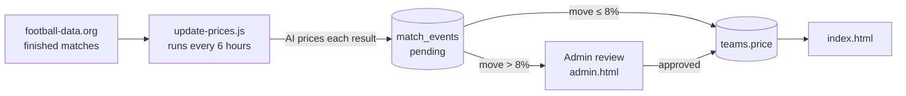

<div align="center">

# PitchMarket

**Trade the table.**

A free-to-play stock market for football clubs, where prices move with real match results.

[](https://github.com/Pitchmarket/Pitchmarket/actions/workflows/update-prices.yml)


</div>

---

## Overview

Every player starts with **2,000 Fan Coins** and buys and sells shares in clubs and national teams across Europe's top leagues, the Champions League and more. After each real match, the result is priced and the club's share price moves. The best portfolio at the end of the season tops the leaderboard.

Paid plans add convenience features such as no ads, alerts and extra data. They never give a trading advantage: everyone competes with the same starting coins.

> [!NOTE]
> PitchMarket is a simulation for entertainment. Prices are not real financial quotes, and Fan Coins have no cash value.

## Contents

- [How it works](#how-it-works)
- [Project structure](#project-structure)
- [Getting started](#getting-started)
- [Configuration](#configuration)
- [Common tasks](#common-tasks)
- [Contributing](#contributing)

## How it works



1. **A match finishes.** The updater fetches results from [football-data.org](https://www.football-data.org) for 10 competitions.
2. **The result is priced.** An AI model (Gemini by default, Claude optional) weighs the score, margin and venue, and proposes a percentage move for each team.
3. **The price updates.** Moves up to 8% are applied automatically. Larger moves wait for an admin to approve them.

## Project structure

| Path | Description |
| --- | --- |
| [`index.html`](index.html) | The public site: markets, trading, portfolio, watchlist, price alerts, leaderboard and plans. |
| [`admin.html`](admin.html) | Admin dashboard: manage teams and leagues, edit site content, and approve price moves. |
| [`update-prices.js`](update-prices.js) | Scheduled job that turns match results into proposed price moves. |
| [`.github/workflows/update-prices.yml`](.github/workflows/update-prices.yml) | Runs the updater every 6 hours (UTC) and on demand. |

**Tech stack:** plain HTML, CSS and JavaScript with no build step · [Supabase](https://supabase.com) for auth, database and server-side functions · [Chart.js](https://www.chartjs.org) for charts · Node 22 and GitHub Actions for the price updater.

### Backend

The browser talks to Supabase with the public **anon key** that is in both HTML files. That key is safe to expose: all access control comes from Row Level Security (RLS) policies and database functions.

| Kind | Names |
| --- | --- |
| Tables | `teams`, `profiles`, `holdings`, `trades`, `watchlist`, `price_history`, `notifications`, `site_settings`, `match_events` |
| Functions | `trade`, `get_leaderboard`, `approve_match_event`, `auto_apply_match_event`, `clear_read_notifications` |

> [!IMPORTANT]
> The database schema, RLS policies and functions are not in this repository yet, so you can't set up your own copy of the backend. Ask a maintainer for access.

## Getting started

### Run the site

There is nothing to build. Serve the folder and open it in a browser:

```bash
npx serve .
```

> [!WARNING]
> Both pages connect to the **production** Supabase project. Anything you do while signed in, such as trades or admin edits, changes live data. Use a test account.

To use a different Supabase project, change `SUPABASE_URL` and `SUPABASE_ANON_KEY` near the top of `index.html` and `admin.html`.

### Run the price updater

```bash
npm install

export FOOTBALL_DATA_API_KEY=...
export SUPABASE_URL=...
export SUPABASE_SERVICE_ROLE_KEY=...   # bypasses RLS: never commit it or put it in HTML
export GEMINI_API_KEY=...

node update-prices.js
```

## Configuration

### Secrets

Set these under **Settings → Secrets and variables → Actions**.

| Secret | Required | Description |
| --- | :---: | --- |
| `FOOTBALL_DATA_API_KEY` | ✓ | API key from [football-data.org](https://www.football-data.org). |
| `SUPABASE_URL` | ✓ | The project URL, the same one used in the HTML files. |
| `SUPABASE_SERVICE_ROLE_KEY` | ✓ | From Supabase → Settings → API. This is **not** the anon key. |
| `GEMINI_API_KEY` | When `AI_PROVIDER=gemini` | From [Google AI Studio](https://aistudio.google.com). The free tier is enough. |
| `ANTHROPIC_API_KEY` | When `AI_PROVIDER=claude` | From the [Claude Console](https://console.anthropic.com). |

### Options

Set these in the workflow's `env:` block.

| Variable | Default | Description |
| --- | --- | --- |
| `AI_PROVIDER` | `gemini` | Which AI prices the results: `gemini` or `claude`. |
| `GEMINI_MODEL` | `gemini-3.6-flash` | Gemini model name. |
| `CLAUDE_MODEL` | see `update-prices.js` | Claude model name. |
| `LOOKBACK_DAYS` | `3` | How many days back to look for finished matches. |
| `AI_BATCH_SIZE` | `10` | Matches priced per AI call (1–25). |
| `AI_MIN_GAP_MS` | `4500` | Minimum milliseconds between AI calls. Raise it if you see HTTP 429 errors. |
| `AI_MAX_RETRIES` | `4` | Retries per AI call. |
| `AI_FAIL_STREAK_ABORT` | `4` | Stop the run after this many AI failures in a row. |
| `AUTO_APPLY` | `false` | Apply small moves without admin approval. The workflow sets this to `true`. |
| `AUTO_APPLY_MAX_PCT` | `8` | Moves larger than this always wait for approval. |

### Manual runs

Go to **Actions → Update PitchMarket prices → Run workflow**. You can override `lookback_days`, `ai_min_gap_ms` and `ai_batch_size` for that run. For example, set `lookback_days` to `14` to catch up after fixing team names.

## Common tasks

<details>
<summary><strong>A club's matches are being skipped</strong></summary>

<br>

The run summary at the end of the workflow log lists every team name from the feed that didn't match a club on the site, already formatted as alias lines. Either rename the club in the admin dashboard to match the feed, or add the line to `NAME_ALIASES` (or `UCL_ALIASES` for the Champions League) in `update-prices.js`.

</details>

<details>
<summary><strong>Adding a league</strong></summary>

<br>

Add the teams in the admin dashboard with a new league key. If their prices should update automatically, also map the football-data.org competition code to that key in `COMPETITIONS` in `update-prices.js`.

</details>

<details>
<summary><strong>Switching the AI provider to Claude</strong></summary>

<br>

In `.github/workflows/update-prices.yml`, set `AI_PROVIDER` to `claude`, add an `ANTHROPIC_API_KEY` secret, and uncomment the `ANTHROPIC_API_KEY` line in the workflow.

</details>

## Contributing

1. Create a branch from `main` and open a pull request. Don't push directly to `main`.
2. Keep pull requests small and focused. `index.html` is one large file, so big changes to it often cause merge conflicts.
3. Include before and after screenshots for any UI change.
4. Never commit secrets. The only key that belongs in the HTML files is the public anon key.
